<div align="center">

# n8n-ai-autonomous-account-research-agent

**Autonomous AI research agent that triggers when a target account is created in HubSpot, querying web intelligence APIs (Exa/Perplexity), summarizing recent news, tech stack shifts, and executive changes, and logging a rich brief into HubSpot.**

A dhRobin Systems Revenue Infrastructure blueprint

      

</div>

---

## Table of Contents

1. [Overview](#1-overview)
2. [Architecture](#2-architecture)
3. [Repository Contents](#3-repository-contents)
4. [Prerequisites](#4-prerequisites)
5. [5-Minute Sandbox Quick Start](#5-5-minute-sandbox-quick-start)
6. [Environment Variables](#6-environment-variables)
7. [Node-by-Node Configuration Guide](#7-node-by-node-configuration-guide)
8. [Safety Matrix](#8-safety-matrix)
9. [Data Protection and Compliance](#9-data-protection-and-compliance)
10. [Deployment and Promotion Path](#10-deployment-and-promotion-path)
11. [Operations, Cost and Troubleshooting](#11-operations-cost-and-troubleshooting)
12. [Extending the Agent](#12-extending-the-agent)
13. [Disclaimer and License](#13-disclaimer-and-license)

---

## 1. Overview

When a rep adds a target account to HubSpot, the first hour of research is usually the same: scan the news, check for funding, look for signs of a platform change, and see who joined the leadership team. I built this agent to do that work the moment the company record is created, and to leave the result where the rep already works: a cited brief on the company timeline.

**On every `company.creation` event, the agent:**

1. **Verifies** the HubSpot v3 request signature and de-duplicates retried or batched events.
2. **Fetches** firmographics for the new company and **qualifies** it: it normalises the domain, rejects consumer, disposable and reserved domains, and applies your target-account criteria.
3. **Researches** three topics in parallel batches through Exa and/or Perplexity: recent news and funding, technology stack shifts, and C-suite/VP changes.
4. **Synthesises** a structured brief through an OpenAI-compatible model with a strict JSON Schema. Every finding must cite a source ID.
5. **Validates** the citations, scrubs contact details, and renders a formatted HubSpot note.
6. **Logs** the note on the company record and, optionally, posts a Slack alert. Each write is gated separately.

**Design principles**

| Principle | Implementation |
|---|---|
| Safe by default | With no environment variables, the agent makes **zero external API calls and zero CRM writes**. |
| Secrets stay out of data | API keys and webhook URLs are referenced only as `{{ $env.* }}` inside HTTP header or URL fields, so they never appear in execution data. |
| Evidence before prose | The model can only cite sources the agent retrieved. Unknown source IDs are removed, and uncited findings are dropped before anything is written. |
| Untrusted web input | Web content is passed to the LLM as data with explicit prompt-injection guards. Contact details are scrubbed before and after synthesis. |
| Privacy by default | Executive changes are reported by role. Person names are included only when `INCLUDE_PERSON_NAMES=true`. |
| Graceful degradation | One failed research call is recorded in the brief and does not stop the run. |

---

## 2. Architecture

```mermaid
flowchart LR
    W[HubSpot: Company<br/>Created Webhook] --> CFG
    M[Manual Test Trigger] --> SYN[Build Synthetic<br/>Webhook Event] --> CFG
    CFG[Config & Safety Gate<br/>$env → config.*] --> VP[Verify & Parse<br/>HubSpot Events<br/>HMAC · dedupe · cap]
    VP --> HE{Has Company<br/>Events?}
    HE -- no --> NE[No Events: End]
    HE -- yes --> SB{Sandbox Mode?}
    SB -- yes --> MC[Mock HubSpot<br/>Company Lookup]
    SB -- no --> GC[HubSpot:<br/>Get Company]
    MC --> NQ[Normalize Domain<br/>& Qualify]
    GC --> NQ
    NQ --> Q{Qualified?}
    Q -- no --> SK[Skipped:<br/>Not Qualified]
    Q -- yes --> BQ[Build Research Queries<br/>news · tech · exec]
    BQ --> RL{Research Live?}
    RL -- no --> MR[Mock Research<br/>Generator]
    RL -- yes --> EE{Exa Enabled?}
    EE -- yes --> EX[Exa: Search] --> AE[Attach Exa Results]
    EE -- no --> SE[Skip Exa]
    AE --> PE{Perplexity<br/>Enabled?}
    SE --> PE
    PE -- yes --> PX[Perplexity: Search] --> AP[Attach Perplexity<br/>Results]
    PE -- no --> SP[Skip Perplexity]
    AP --> AG
    SP --> AG
    MR --> AG[Aggregate Research<br/>per Company<br/>S1…Sn citations]
    AG --> BS[Build Synthesis<br/>Request] --> LL{LLM Live?}
    LL -- yes --> OA[OpenAI: Synthesize<br/>Brief]
    LL -- no --> MS[Mock Synthesis]
    OA --> VR[Validate Brief<br/>& Render Note]
    MS --> VR
    VR --> DR{Dry Run?}
    DR -- yes --> PV[Dry Run:<br/>Brief Preview]
    DR -- no --> WH{Write to<br/>HubSpot?} --> HN[HubSpot: Create<br/>Company Note]
    DR -- no --> NS{Notify Slack?} --> SL[Slack: Post Alert]
```



### Stage contracts

| Stage | Output shape |
|---|---|
| Verify & Parse HubSpot Events | One item per new company: `{ companyId, portalId, eventId, occurredAt, signature, counters }` |
| Normalize Domain & Qualify | `{ companyId, portalId, qualified, disqualifyReason, checks, company: { name, domain, industry, employees, … } }` |
| Build Research Queries | One item per (company, topic): `{ …, topic, exaBody, perplexityBody }` |
| Attach / Skip / Mock research | `{ …, exa: [{ title, url, publishedDate, snippet }], perplexity: { answer, sources } }` |
| Aggregate Research per Company | `{ companyId, company, sources: [{ id: "S1", url, host, topics, firstParty, mentionsCompany, … }], answers, research }` |
| OpenAI / Mock Synthesis | Chat Completions envelope; `choices[0].message.content` is the brief JSON |
| Validate Brief & Render Note | `{ brief, citedSources, quality, noteHtml, notePayload, slackPayload, dryRun, writeToHubspot, notifySlack }` |

### Brief schema (strict)

| Field | Type | Rule |
|---|---|---|
| `executive_summary` | string | 3–5 sentences on why the account matters now |
| `recent_news[]` | `{ headline, summary, date, source_ids[] }` | At least one valid source ID |
| `tech_stack_shifts[]` | `{ technology_area, change, evidence, source_ids[] }` | `change` ∈ `adopted · expanded · replaced · evaluating · deprecated` |
| `executive_changes[]` | `{ role, change_type, person, date, source_ids[] }` | `change_type` ∈ `appointed · promoted · departed`; `person` = `Not disclosed` unless names are enabled |
| `outbound_hooks[]` | `{ persona, angle, opener, source_ids[] }` | 2–4 hooks; `opener` ≤ 280 characters, tied to a cited fact |
| `risks_or_unknowns[]` | string[] | Evidence gaps |
| `confidence` | `high · medium · low` | Forced to `low` when research is mocked |

---

## 3. Repository Contents

```
n8n-ai-autonomous-account-research-agent/
├── README.md        Technical documentation (this file)
├── workflow.json    Importable n8n workflow with sticky notes and pinned synthetic payloads
├── DISCLAIMER.md    Liability limitation and usage terms
└── LICENSE          MIT License
```

All logic runs in native n8n nodes and Code nodes. No community nodes or external packages are needed.

---

## 4. Prerequisites

| Requirement | Detail |
|---|---|
| n8n | Self-hosted **1.60 or later** (Webhook 2, Set 3.4, IF 2, Code 2, HTTP Request 4.2, `v1` execution order). |
| Env access | `N8N_BLOCK_ENV_ACCESS_IN_NODE=false`. Recent n8n releases block `$env` in nodes by default, so set this explicitly. |
| Crypto in Code nodes | `NODE_FUNCTION_ALLOW_BUILTIN=crypto`, needed for HubSpot signature verification. |
| Public HTTPS URL | HubSpot must reach the production webhook URL (`WEBHOOK_URL` set on n8n). |
| HubSpot app | A private (or public) app with a **`company.creation` webhook subscription**, its **client secret** (for signature checks), and an access token with company read and note write scopes (see [§7.6](#76-hubspot-get-company) and [§7.17](#717-hubspot-create-company-note)). Start with a developer test account. |
| Exa (optional) | API key for `https://api.exa.ai/search`. |
| Perplexity (optional) | API key for `https://api.perplexity.ai/chat/completions`. |
| LLM (optional) | An OpenAI key or any OpenAI-compatible endpoint that supports `response_format: json_schema`. |
| Slack (optional) | Incoming webhook URL for an alerts channel. |

> **n8n Cloud:** you can't define your own environment variables on n8n Cloud. Replace each `$env.X` with `$vars.X` (on plans with Variables) or move the secret into an n8n credential. The node logic is unchanged.

---

## 5. 5-Minute Sandbox Quick Start

1. **Run n8n locally:**
   ```bash
   docker run -it --rm -p 5678:5678 \
     -e N8N_BLOCK_ENV_ACCESS_IN_NODE=false \
     -e NODE_FUNCTION_ALLOW_BUILTIN=crypto \
     -e GENERIC_TIMEZONE=UTC \
     -v n8n_data:/home/node/.n8n \
     docker.n8n.io/n8nio/n8n
   ```
2. **Import** `workflow.json` (*Workflows → Import from File*).
3. Click **Test workflow** and choose *Manual Test Trigger*. Alternatively, run from the webhook node, which uses its pinned synthetic event.
4. Open **Dry Run: Brief Preview** and inspect `brief`, `noteHtml`, `notePayload` and `slackPayload`.
5. Open **Skipped: Not Qualified** to see the second synthetic company rejected with `missing_domain`. Check `counters.duplicateInBatch` on *Verify & Parse* to see the duplicate event removed.

No credentials are required and nothing leaves the instance. The synthetic entity is **Acme Logistics Corp** (`acme-logistics.example`). All sources point at `.example` hosts.

---

## 6. Environment Variables

All variables are optional. Unset values resolve to the safest behaviour.

### 6.1 Safety gate

| Variable | Default | Behaviour |
|---|---|---|
| `SANDBOX_MODE` | `true` | Any value except `false` forces mock company lookup, mock research and mock synthesis. Zero external calls. |
| `DRY_RUN` | `true` | Any value except `false` stops at *Dry Run: Brief Preview*. |
| `WRITE_TO_HUBSPOT` | `false` | Must be exactly `true` (with `DRY_RUN=false`) to create the note. |
| `NOTIFY_SLACK` | `false` | Must be exactly `true` (with `DRY_RUN=false`) to post the alert. |
| `RESEARCH_MODE` | `mock` | `exa`, `perplexity` or `both`. Ignored while `SANDBOX_MODE` is on. |
| `LLM_MODE` | `mock` | `live` calls the LLM endpoint. Ignored while `SANDBOX_MODE` is on. |
| `REQUIRE_HUBSPOT_SIGNATURE` | `true` | Any value except `false` rejects unsigned or invalid requests. It is skipped only in sandbox mode. |

### 6.2 Secrets (referenced only in HTTP nodes, plus the HMAC check)

| Variable | Used by | Notes |
|---|---|---|
| `HUBSPOT_PRIVATE_APP_TOKEN` | HubSpot: Get Company, HubSpot: Create Company Note | `Authorization: Bearer …` |
| `HUBSPOT_APP_CLIENT_SECRET` | Verify & Parse HubSpot Events | The single secret read outside an HTTP node, because an HMAC can't be computed in a header field. It is held in memory and never output. |
| `EXA_API_KEY` | Exa: Search | `x-api-key` header |
| `PERPLEXITY_API_KEY` | Perplexity: Search | `Authorization: Bearer …` |
| `OPENAI_API_KEY` | OpenAI: Synthesize Brief | `Authorization: Bearer …` |
| `SLACK_WEBHOOK_URL` | Slack: Post Alert | The URL is the secret |

### 6.3 Qualification

| Variable | Default | Description |
|---|---|---|
| `TARGET_MIN_EMPLOYEES` | `0` (off) | Minimum `numberofemployees`. Unknown counts pass with a `employee_count_unknown` check flag. |
| `TARGET_COUNTRIES` | *(all)* | Comma-separated values matched case-insensitively against `country`. |
| `TARGET_INDUSTRIES` | *(all)* | Comma-separated HubSpot industry enum values, for example `LOGISTICS_AND_SUPPLY_CHAIN,COMPUTER_SOFTWARE`. |
| `REQUIRE_TARGET_ACCOUNT_FLAG` | `false` | When `true`, only companies with `hs_is_target_account = true` are researched. |
| `EXTRA_BLOCKED_DOMAINS` | *(empty)* | Comma-separated domains added to the consumer/disposable blocklist (subdomains included). |

### 6.4 Research and synthesis

| Variable | Default | Description |
|---|---|---|
| `RESEARCH_LOOKBACK_DAYS` | `90` | 7–365. Sets Exa `startPublishedDate` and the Perplexity recency filter (`week`, `month` or `year`). |
| `EXA_NUM_RESULTS` | `5` | 1–10 results per topic. |
| `PERPLEXITY_MODEL` | `sonar` | Any Sonar model your plan includes. |
| `OPENAI_BASE_URL` | `https://api.openai.com/v1` | Any OpenAI-compatible gateway. |
| `OPENAI_MODEL` | `gpt-4.1-mini` | `temperature` is omitted automatically for `o*` and `gpt-5*` model families. |
| `INCLUDE_PERSON_NAMES` | `false` | When `true`, publicly reported executive names may appear in the brief. |

### 6.5 Runtime

| Variable | Default | Description |
|---|---|---|
| `MAX_COMPANIES_PER_RUN` | `10` | 1–50. Caps a batched webhook delivery. |
| `DEDUPE_TTL_HOURS` | `24` | Suppresses re-research of the same company across production executions. |
| `HUBSPOT_WEBHOOK_PUBLIC_URL` | *(webhook URL)* | Exact public URL HubSpot calls. Set it when n8n sits behind a proxy that rewrites the host. |
| `HUBSPOT_API_BASE_URL` | `https://api.hubapi.com` | API base. |
| `HUBSPOT_UI_BASE_URL` | `https://app.hubspot.com` | Used for the *Open in HubSpot* button (`https://app-eu1.hubspot.com` for EU portals). |

### 6.6 Sample `.env` (staging)

```dotenv
# n8n runtime
N8N_BLOCK_ENV_ACCESS_IN_NODE=false
NODE_FUNCTION_ALLOW_BUILTIN=crypto
WEBHOOK_URL=https://n8n.staging.example/
GENERIC_TIMEZONE=UTC

# Safety gate: live research against a HubSpot test portal, no writes yet
SANDBOX_MODE=false
DRY_RUN=true
WRITE_TO_HUBSPOT=false
NOTIFY_SLACK=false
RESEARCH_MODE=both
LLM_MODE=live
REQUIRE_HUBSPOT_SIGNATURE=true

# Secrets (inject from your secret manager; never commit)
HUBSPOT_PRIVATE_APP_TOKEN=replace-with-test-portal-token
HUBSPOT_APP_CLIENT_SECRET=replace-with-app-client-secret
EXA_API_KEY=replace-with-exa-key
PERPLEXITY_API_KEY=replace-with-perplexity-key
OPENAI_API_KEY=replace-with-openai-key
SLACK_WEBHOOK_URL=https://hooks.slack.example/services/REPLACE/ME

# Qualification
TARGET_MIN_EMPLOYEES=200
TARGET_COUNTRIES=United States,Canada
REQUIRE_TARGET_ACCOUNT_FLAG=false

# Research
RESEARCH_LOOKBACK_DAYS=90
EXA_NUM_RESULTS=5
INCLUDE_PERSON_NAMES=false
```

---

## 7. Node-by-Node Configuration Guide

### 7.1 HubSpot: Company Created Webhook
- **Type:** Webhook v2, `POST /webhook/hubspot/company-created`, **responds 200 immediately** so HubSpot never times out or retries because of research latency.
- **HubSpot setup:** in your app's *Webhooks* settings, set the target URL to the n8n **production** webhook URL and subscribe to **Company → Created** (`company.creation`). HubSpot batches events, and the agent processes up to `MAX_COMPANIES_PER_RUN` per request.
- **Workflow-webhook alternative:** a HubSpot workflow *Send a webhook* action that posts `objectId` also works. Signature verification then needs `REQUIRE_HUBSPOT_SIGNATURE=false` plus a network-level control, because workflow webhooks are not signed with the app secret.
- **Pinned:** one synthetic request with two events.

### 7.2 Manual Test Trigger → Build Synthetic Webhook Event
This path emits a webhook-shaped request with three fictitious events: Acme, a test record with no domain, and a duplicate Acme event. It runs exactly the same parsing logic as production.

### 7.3 Config & Safety Gate
- **Type:** Set v3.4 with *Include Other Fields*. The incoming request passes through, and typed configuration is added under `config.*`.
- **Effective flags:** `researchLive`, `useExa`, `usePerplexity` and `llmLive` are all `false` while `SANDBOX_MODE` is on, whatever their own variables say.
- **Fail-safe parsing:** safety flags stay on unless they are set to exactly `false`. Write flags stay off unless they are set to exactly `true`. Numeric values are clamped to safe ranges.

### 7.4 Verify & Parse HubSpot Events
| Step | Detail |
|---|---|
| Signature | HubSpot v3: `base64(HMAC-SHA256(clientSecret, "POST" + uri + body + timestamp))`, compared with `timingSafeEqual`. Requests older than 5 minutes are rejected as possible replays. |
| URI | `HUBSPOT_WEBHOOK_PUBLIC_URL` if set, otherwise the node's `webhookUrl`. |
| Body | The JSON body is re-serialised compactly, which matches HubSpot's compact payloads. If your proxy alters the body, enable *Raw Body* on the Webhook node and adapt the `rawBody` line. |
| Filtering | Keeps `company.creation` events (or workflow-webhook objects with a numeric `objectId`). |
| De-duplication | Within the batch, plus across production executions via workflow static data for `DEDUPE_TTL_HOURS`. Manual runs never persist static data. |
| Counters | `received`, `ignoredType`, `duplicateInBatch`, `recentlyProcessed`, `overCap`. |

Rejected requests fail the execution with a clear `Rejected: …` message, so they surface in your Error Workflow.

### 7.5 Has Company Events? / Sandbox Mode?
These are gates. With no events, the run ends at *No Events: End* with `skipReason` and `counters` for inspection. In sandbox mode, the real HubSpot lookup is replaced by *Mock HubSpot Company Lookup*.

### 7.6 HubSpot: Get Company
- `GET /crm/v3/objects/companies/{companyId}?properties=name,domain,website,industry,numberofemployees,annualrevenue,country,city,hs_is_target_account,lifecyclestage,createdate`
- **Scope:** `crm.objects.companies.read`.
- **Throughput:** batches of 5 per second, with 3 retries 4 s apart.
- **Data minimisation:** no contacts, owners or associations are requested.
- **Pinned:** two synthetic company records in event order.

### 7.7 Normalize Domain & Qualify
| Check | Rule | `disqualifyReason` |
|---|---|---|
| Presence | `domain`, falling back to `website` | `missing_domain` |
| Normalisation | Lower-case; strips scheme, path, query, port, trailing dot, `www`/`www2`, and email local parts | — |
| Syntax | RFC-style labels, 4–253 characters, alphabetic or IDN (`xn--`) TLD | `invalid_domain`, `ip_address_not_domain` |
| Reserved TLDs | `.test`, `.invalid`, `.localhost`, `.local`, `.internal`, `.lan`; `.example` in production executions only | `reserved_tld` |
| Consumer/disposable | Built-in free-mail and throwaway lists plus `EXTRA_BLOCKED_DOMAINS`, subdomains included | `consumer_or_disposable_domain` |
| Firmographics | `TARGET_MIN_EMPLOYEES`, `TARGET_COUNTRIES`, `TARGET_INDUSTRIES` | `below_min_employees`, `country_not_targeted`, `industry_not_targeted` |
| ABM flag | `REQUIRE_TARGET_ACCOUNT_FLAG` → `hs_is_target_account` | `not_flagged_target_account` |

> The built-in blocklists name public free-mail and disposable-mail providers. They exist purely as filters and contain no client data.

### 7.8 Build Research Queries
For each qualified company, this node emits three topic items with pre-built bodies:

| Topic | Exa query focus | Exa category | Perplexity question |
|---|---|---|---|
| `news` | Funding, acquisitions, partnerships, expansion, launches | `news` | Material business news since the lookback date |
| `tech` | Adopts, migrates, selects or replaces platforms | — | Evidence of stack changes, including job postings and case studies |
| `exec` | Appoints, hires or names chief officers and VPs | `news` | C-suite/VP appointments, promotions and departures |

Each query is anchored to the **domain** so that organisations with similar names are excluded.

### 7.9 Research Live? → Exa Enabled? → Perplexity Enabled?
These gates are global, not per item, so each downstream node runs exactly once per execution. When a provider is excluded, the *Skip* node passes the items through with empty results and the shape stays identical.

### 7.10 Exa: Search
- `POST https://api.exa.ai/search`, header `x-api-key: {{ $env.EXA_API_KEY }}`.
- Body: `query`, `type: auto`, `numResults`, `startPublishedDate`, `contents.text.maxCharacters: 1200`, and an optional `category`.
- One request every 400 ms, 3 retries. **On error: continue.** The failure is recorded in `research.errors` and the brief proceeds on the remaining evidence.
- **Pinned:** three synthetic responses (news, tech, exec).

### 7.11 Perplexity: Search
- `POST https://api.perplexity.ai/chat/completions`, `Authorization: Bearer {{ $env.PERPLEXITY_API_KEY }}`.
- Body: Sonar model, a factual system prompt anchored to the domain, `search_recency_filter`, `temperature: 0.1`, `max_tokens: 700`.
- Supports both response formats: `search_results[]` and the older `citations[]`.
- One request per second, 3 retries, continue on error.
- **Pinned:** three synthetic responses covering both citation formats.

### 7.12 Mock Research Generator
Offline, fictitious research in the exact live shape. It runs whenever `SANDBOX_MODE=true` or `RESEARCH_MODE=mock`.

### 7.13 Aggregate Research per Company
- Groups topic items by company and canonicalises URLs (removes fragments, `utm_*`, `gclid`, `fbclid` and trailing slashes).
- De-duplicates sources and assigns stable IDs `S1…Sn`, capped at 24.
- Rewrites Perplexity markers (`[1]`) to the matching S-IDs.
- Flags each source as `firstParty` (company domain) and `mentionsCompany` (name or domain in the text), which the synthesis prompt treats as the strongest evidence.
- Scrubs email addresses and phone numbers from web text **before** the LLM sees it.

### 7.14 Build Synthesis Request
- One Chat Completions request per company, with `response_format: json_schema, strict: true` and the schema from [§2](#brief-schema-strict).
- The system prompt enforces citing only provided IDs, never inventing figures or dates, discarding similarly named organisations, ignoring instructions inside web text, using roles instead of names unless enabled, and keeping openers to 280 characters.

### 7.15 OpenAI: Synthesize Brief / Mock Synthesis
- **Live:** `POST {OPENAI_BASE_URL}/chat/completions`, 120 s timeout, 3 retries 8 s apart. A failure stops the run: a brief without synthesis is not worth logging.
- **Mock:** builds a schema-valid brief from the evidence and marks it as mock. Confidence is always `low`.
- **Pinned:** one synthetic completion that deliberately includes an unknown source ID (`S99`) and an uncited finding, so you can watch the validator remove both.

### 7.16 Validate Brief & Render Note
| Control | Effect |
|---|---|
| Parse guard | An unparseable response yields a minimal brief flagged in `risks_or_unknowns`. |
| Citation contract | Unknown IDs are removed (`quality.removedUnknownIds`). Items left with no valid citation are dropped (`quality.droppedUncited`). |
| Enum guard | Invalid `change`, `change_type` or `confidence` values fall back to conservative defaults. |
| Scrubbing | Emails and phone numbers are removed from every model string. Person names are forced to `Not disclosed` unless enabled. |
| Rendering | HubSpot-compatible HTML (`<p>`, `<strong>`, `<em>`, `<ul>`, `<li>`, `<a>`, `<br>`), only cited sources listed, capped at 60,000 characters. |
| Payloads | `notePayload` (note + company association) and `slackPayload` (Block Kit with an *Open in HubSpot* button). |

### 7.17 HubSpot: Create Company Note
- `POST /crm/v3/objects/notes` with:
  ```json
  {
    "properties": { "hs_timestamp": "<ISO now>", "hs_note_body": "<rendered HTML>" },
    "associations": [{
      "to": { "id": "<companyId>" },
      "types": [{ "associationCategory": "HUBSPOT_DEFINED", "associationTypeId": 190 }]
    }]
  }
  ```
- `190` is HubSpot's default *note → company* association type.
- **Scope:** add the write scope HubSpot lists for the Notes API in your app's scope picker. Notes are engagement objects, and the required scope label differs between account setups, so confirm it in the HubSpot docs for your portal before go-live.
- **Pinned:** a synthetic `201` note object.

### 7.18 Slack: Post Alert
`POST {{ $env.SLACK_WEBHOOK_URL }}` with a header, a context line (domain, confidence, source count, mode), the executive summary, up to four hooks, and a record button. **Pinned:** `ok`.

---

## 8. Safety Matrix

| `SANDBOX_MODE` | `RESEARCH_MODE` | `LLM_MODE` | `DRY_RUN` | `WRITE_TO_HUBSPOT` | `NOTIFY_SLACK` | HubSpot read | Exa / Perplexity | LLM | Note written | Slack sent |
|:---:|:---:|:---:|:---:|:---:|:---:|:---:|:---:|:---:|:---:|:---:|
| `true` *(default)* | any | any | `true` *(default)* | `false` *(default)* | `false` *(default)* | No | No | No | No | No |
| `false` | `mock` | `mock` | `true` | any | any | Yes | No | No | No | No |
| `false` | `exa` / `perplexity` / `both` | `live` | `true` | any | any | Yes | Yes | Yes | No | No |
| `false` | `both` | `live` | `false` | `false` | `true` | Yes | Yes | Yes | No | Yes |
| `false` | `both` | `live` | `false` | `true` | `false` | Yes | Yes | Yes | **Yes** | No |
| `false` | `both` | `live` | `false` | `true` | `true` | Yes | Yes | Yes | **Yes** | Yes |

**Pinned data:** pins apply only to manual executions. A production webhook execution always calls live endpoints according to the matrix above. Before a manual test of a live integration, unpin that node (*right-click → Unpin*), or the pinned response is returned instead.

---

## 9. Data Protection and Compliance

| Data element | Source | Sent to research APIs | Sent to LLM | Written to HubSpot / Slack |
|---|---|:---:|:---:|:---:|
| Company name, domain | HubSpot | Yes (query text) | Yes | Yes |
| Industry, employees, country | HubSpot | No | Yes | No |
| Contacts, owners, deals | — | Never fetched | No | No |
| Public web snippets | Exa / Perplexity | — | Yes, after contact scrubbing | Paraphrased with citations |
| Executive names | Public web | — | Only if returned by sources | Only with `INCLUDE_PERSON_NAMES=true` |
| Emails, phone numbers | Public web | — | Removed | Removed |

**My recommendations before going live**

- Confirm that your use of public business information about companies and their executives fits your privacy notice and lawful basis (GDPR Art. 6(1)(f) legitimate-interest assessment, CCPA notice at collection).
- Review the data retention and training terms of Exa, Perplexity and your LLM provider. Prefer zero-retention or enterprise endpoints, and route through `OPENAI_BASE_URL` if you require a private gateway.
- Keep `INCLUDE_PERSON_NAMES=false` unless your sales team has a documented need for named contacts in CRM notes.
- Restrict access to n8n executions, which contain retrieved web text, and set `EXECUTIONS_DATA_PRUNE=true` with a short `EXECUTIONS_DATA_MAX_AGE`.
- Treat every brief as AI-generated research. A person verifies the cited facts before any outreach uses them.

---

## 10. Deployment and Promotion Path

### 10.1 Docker Compose

```yaml
services:
  n8n:
    image: docker.n8n.io/n8nio/n8n:latest   # pin a tested version tag in production
    restart: unless-stopped
    ports:
      - "5678:5678"
    env_file:
      - ./.env                              # never commit this file
    environment:
      - N8N_BLOCK_ENV_ACCESS_IN_NODE=false
      - NODE_FUNCTION_ALLOW_BUILTIN=crypto
      - WEBHOOK_URL=https://n8n.company.example/
      - EXECUTIONS_DATA_PRUNE=true
      - EXECUTIONS_DATA_MAX_AGE=168
      - N8N_ENCRYPTION_KEY=${N8N_ENCRYPTION_KEY}
    volumes:
      - n8n_data:/home/node/.n8n
volumes:
  n8n_data:
```

### 10.2 Promotion path

| Stage | Environment | Configuration | Exit criteria |
|---|---|---|---|
| 1. Sandbox | Any n8n instance | Defaults | Brief renders. Globex skipped with `missing_domain`. Duplicate event removed. |
| 2. Pinned live path | Same | `SANDBOX_MODE=false`, `RESEARCH_MODE=both`, `LLM_MODE=live`, `REQUIRE_HUBSPOT_SIGNATURE=false`, manual run | Every node executes on pins. `removedUnknownIds = 1`, `droppedUncited = 1`. |
| 3. Live research | HubSpot developer test account | Unpin Exa, Perplexity and OpenAI. Keep `DRY_RUN=true` | Briefs cite real sources. No hallucinated IDs. Cost per company within budget. |
| 4. Signed webhooks | Test account + public URL | `REQUIRE_HUBSPOT_SIGNATURE=true`, client secret set, workflow **active** | Creating a test company triggers a verified execution. |
| 5. Write test | Test account | `DRY_RUN=false`, `WRITE_TO_HUBSPOT=true`, `NOTIFY_SLACK=true` to a test channel | The note appears on the company timeline and the Slack alert renders. |
| 6. Production | Production portal | Production secrets, qualification criteria tuned | Two weeks of briefs reviewed by sales leadership before wide rollout. |

### 10.3 Version control hygiene
Export the workflow after each change and commit `workflow.json`. Before committing, confirm that it holds only `$env` references and synthetic pins:

```bash
grep -nE '(pat-[a-z0-9]|sk-[A-Za-z0-9]|pplx-[A-Za-z0-9]|xox[bp]-|hooks\.slack\.com)' workflow.json && echo "Possible secret found" || echo "Clean"
```

---

## 11. Operations, Cost and Troubleshooting

### 11.1 Cost and latency per company (typical)

| Step | Calls | Notes |
|---|---|---|
| HubSpot read + note | 2 | Well within private-app rate limits |
| Exa | 3 | One per topic |
| Perplexity | 3 | One per topic, about 0.7k output tokens each |
| LLM synthesis | 1 | About 3–6k input tokens and 0.6–1.2k output tokens |
| End-to-end latency | — | Usually 20–60 seconds after the webhook is acknowledged |

### 11.2 Quality signals (`quality` on *Validate Brief & Render Note*)

| Signal | Healthy | Action if not |
|---|---|---|
| `parseError` | `false` | Choose a model with structured-output support. |
| `removedUnknownIds` | `0` | Lower `EXA_NUM_RESULTS`, or move to a stronger model. |
| `droppedUncited` | `0–1` | Persistent drops indicate weak evidence. Widen `RESEARCH_LOOKBACK_DAYS`. |
| `citedCount / sourceCount` | ≥ 40% | Low values mean noisy sources. Tighten queries in *Build Research Queries*. |
| `researchErrors` | `[]` | Check provider keys, quotas and status pages. |

### 11.3 Troubleshooting

| Symptom | Cause | Resolution |
|---|---|---|
| `access to env vars denied` | Env access blocked | Set `N8N_BLOCK_ENV_ACCESS_IN_NODE=false` and restart n8n. |
| `needs NODE_FUNCTION_ALLOW_BUILTIN=crypto` | Built-in modules blocked | Add `NODE_FUNCTION_ALLOW_BUILTIN=crypto`. |
| `Rejected: HubSpot v3 signature mismatch` | URL or body differs from what HubSpot signed | Set `HUBSPOT_WEBHOOK_PUBLIC_URL` to the exact public URL. Check that your proxy does not rewrite the body. |
| `Rejected: … outside the allowed window` | Clock skew or replay | Sync the server clock (NTP). Replays are rejected by design. |
| No executions on company create | Workflow inactive or test URL used | Activate the workflow and subscribe HubSpot to the **production** URL. |
| Every company `reserved_tld` in production | `.example` test data | Expected: `.example` is accepted only in sandbox and manual runs. |
| Manual run returns Acme every time | Nodes are pinned | Unpin the relevant HTTP nodes. |
| HubSpot `403` on note creation | Missing write scope | Add the Notes API write scope listed for your app and reinstall it. |
| Note not visible on company | Association missing | Confirm `associationTypeId: 190` and that `companyId` is numeric. |
| Exa `401` / Perplexity `401` | Invalid key | Rotate the key in your secret store. |
| OpenAI `400` on `response_format` | Model lacks structured outputs | Use a model that supports `json_schema`. |
| Duplicate notes | Same company re-created, or manual reruns | Production de-duplication covers `DEDUPE_TTL_HOURS`. Manual runs are not de-duplicated by design. |

---

## 12. Extending the Agent

- **Write-back properties:** store `confidence`, `last_researched_at` and the top hook in custom company properties for list segmentation (needs a companies write scope).
- **Account tiering:** route `high` confidence briefs to an AE and `low` ones to an SDR review queue.
- **Additional topics:** add an entry to `TOPICS` in *Build Research Queries* (for example hiring velocity or regulatory events). The aggregation and validation stages adapt automatically.
- **Refresh cadence:** add a Schedule Trigger that re-emits company IDs for target accounts every 30 days, reusing the same pipeline.
- **Alternative providers:** any search API can replace Exa or Perplexity, as long as its *Attach* node emits `{ title, url, publishedDate, snippet }`.

---

## 13. Disclaimer and License

### ⚠️ Disclaimer & Liability Limitation

**Use at your own risk.** The code, workflows, and scripts in this repository (`n8n-ai-autonomous-account-research-agent`) are provided for educational and architectural demonstration purposes.

- **No Liability:** The author and dhRobin Systems accept no responsibility or liability for any direct, indirect, incidental, or consequential damages that result from using, misusing, or deploying these scripts.
- **No Warranty:** All software, n8n JSON blueprints, JavaScript modules and prompts are provided "AS IS", without warranty of any kind, express or implied. This includes, but is not limited to, warranties of merchantability, fitness for a particular purpose, and non-infringement.
- **Production Testing Required:** Always test thoroughly in an isolated staging environment, such as a HubSpot developer test account or sandbox, with `SANDBOX_MODE=true`, `DRY_RUN=true` and `WRITE_TO_HUBSPOT=false` enabled, before you connect live HubSpot, Exa, Perplexity or OpenAI credentials. Treat every generated account brief as a draft that a person must verify before it's relied on or used in outreach.
- **Third-Party APIs & Compliance:** You alone are responsible for complying with the terms of service, rate limits, data privacy regulations (GDPR/CCPA), and security policies of HubSpot, Exa, Perplexity, OpenAI, Slack and any connected services. That includes confirming a lawful basis for processing public information about companies and their executives, reviewing what each AI provider retains, keeping personal data out of CRM notes and alerts, and reviewing every automatically created or updated record.

The full disclaimer is also available in [DISCLAIMER.md](DISCLAIMER.md).

### License

Released under the MIT License. Copyright (c) 2026 DH Robin (dhRobin Systems). See [LICENSE](LICENSE).

---

Full text: DISCLAIMER.md · Licensed under the MIT License. License: MIT © 2026 dhRobin Systems · Provided as-is, see the disclaimer.
